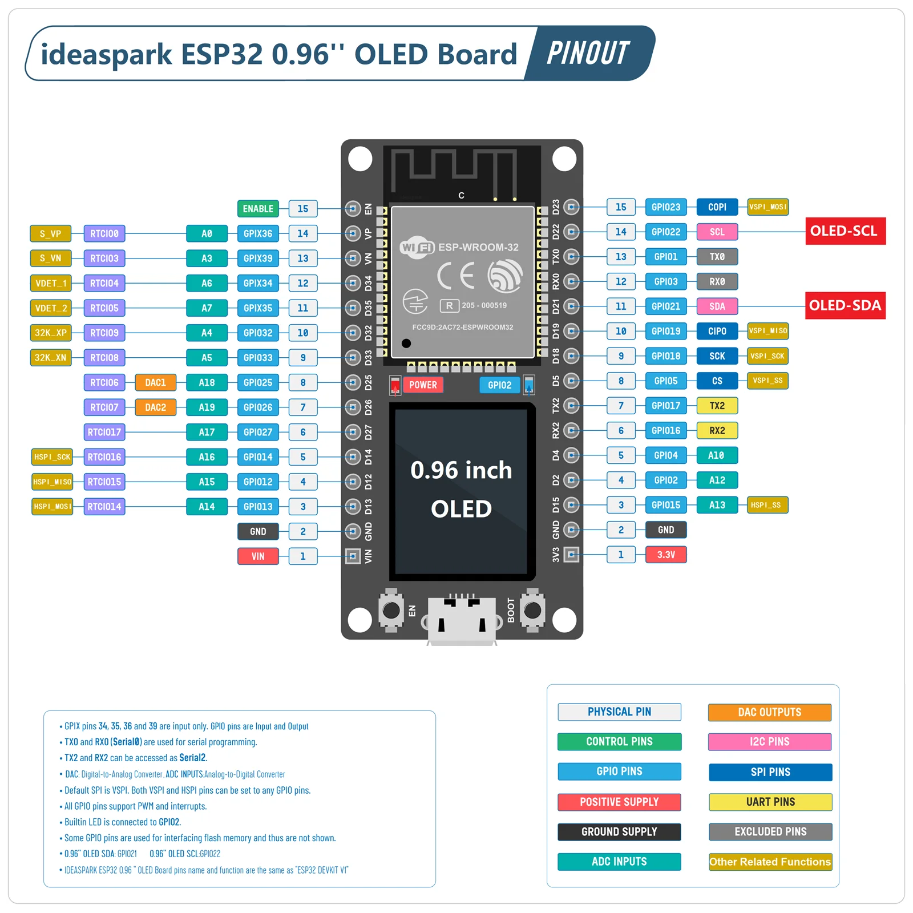
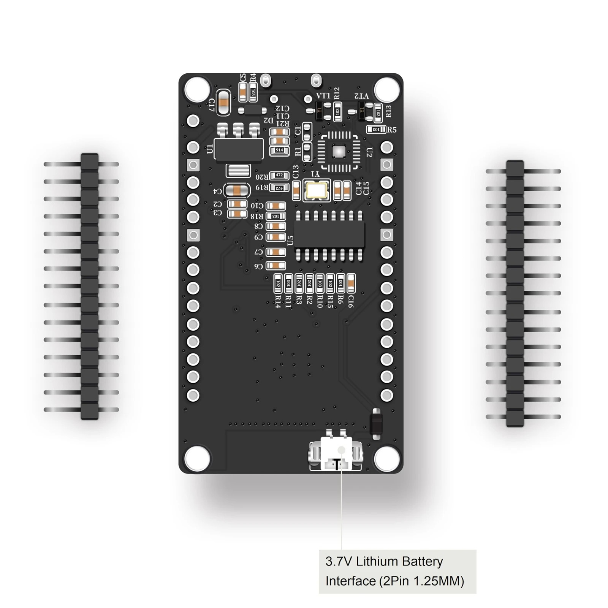

# esp32-ex1

ideaspark ESP32 0.96인치 OLED 보드용 TinyGo 펌웨어입니다. WiFi로 AP에 접속한 뒤 10초마다 Prometheus Pushgateway에 심박 메트릭을 보내고, 내장 OLED에는 `MANTY`를 반복해서 흘려 씁니다.

구매 페이지: [ideaspark ESP32 Development Board with 0.96 Inch OLED](https://ko.aliexpress.com/item/1005006269242344.html)

## 보드

판매 이름은 **ideaspark ESP32 Development Board with 0.96 Inch OLED Display**입니다. 옵션 표기는 `ESP32 096 in OLED`이고, 판매자는 ideaspark입니다. ESP32 DevKit V1과 같은 핀 배치에 0.96인치 OLED를 기판 위에 붙인 형태입니다. USB-UART는 CH340이고 커넥터는 Micro USB입니다.

앞면 배치와 핀 이름은 판매 페이지의 핀아웃입니다. 오른쪽 헤더의 GPIO21이 OLED SDA, GPIO22가 OLED SCL입니다.



뒷면 아래쪽 흰색 커넥터는 1셀 리튬 전지용입니다. 표기는 **3.7V, 2핀, 1.25mm**입니다. 이 커넥터에 5V를 넣지 않습니다. USB 전원은 Micro USB 5V를 사용합니다.



### 판매 사양

아래 표는 판매 페이지와 동봉 안내의 사양입니다.

| 항목 | 값 |
|------|-----|
| 모듈 | ESP32-WROOM-32 (Xtensa 듀얼 코어, 최고 240MHz) |
| 무선 | 2.4GHz WiFi 802.11 b/g/n, Bluetooth v4.2 BR/EDR + BLE |
| 플래시 | 4MB (32Mbit) |
| SRAM | 520KB |
| USB | Micro USB, CH340 USB-UART |
| OLED | 0.96인치, 128×64, SSD1306, I2C 주소 `0x3C`, 파란색 |
| OLED 결선 | SDA = GPIO21, SCL = GPIO22. 기판에 이미 연결되어 있다 |
| 내장 LED | GPIO2 |
| 전원 | Micro USB 5V, 또는 뒷면 3.7V 리튬 전지 (2핀 1.25mm) |
| 동작 전압 | 3.3V (핀의 3V3 출력) |
| 기판 크기 | 53.2mm × 28.7mm |
| 버튼 | EN(리셋), BOOT(GPIO0, 다운로드) |

핀 헤더는 DevKit V1과 같습니다. 왼쪽 아래가 VIN, 그 위가 GND입니다. 오른쪽 아래가 3V3, 그 위가 GND입니다. GPIO34, GPIO35, GPIO36, GPIO39는 입력 전용입니다. GPIO25와 GPIO26은 DAC입니다. SPI 기본 핀은 SCK GPIO18, MISO GPIO19, MOSI GPIO23입니다. 시리얼 프로그래밍은 TX0 GPIO1, RX0 GPIO3이고 CH340이 이 핀에 연결되어 있습니다.

OLED가 쓰는 GPIO21과 GPIO22는 헤더에도 나와 있습니다. 같은 I2C 버스에 다른 장치를 달면 주소 `0x3C`와 겹치지 않아야 합니다.

## 이 펌웨어가 쓰는 핀

| 기능 | 핀 |
|------|-----|
| OLED SDA | GPIO21 |
| OLED SCL | GPIO22 |
| 로그 UART | GPIO1 TX, GPIO3 RX (CH340, 115200 baud) |
| WiFi | ESP32-WROOM-32 내장 안테나. 별도 핀 없음 |

`display.go`는 I2C0를 400kHz로 열고 SSD1306 주소 `0x3C`에 붙습니다. 판매 사양의 패널은 128×64입니다. 이 펌웨어는 예전 스케치와 같이 높이를 32로 초기화해서 위쪽 세 줄만 씁니다. 7×10 글꼴로 `MANTY `를 가로로 반복하고, 줄마다 두 글자씩 어긋나게 둔 뒤 400ms마다 한 글자씩 밉니다.

GPIO2 내장 LED는 핀아웃에 표시되어 있지만 이 펌웨어는 켜지 않습니다.

## 동작

부팅 후 OLED 스크롤을 시작하고 WiFi에 접속합니다. 접속에 성공하면 바로 한 번, 이후 10초마다 다음 주소로 POST합니다.

`http://192.168.31.102:9091/metrics/job/esp32-ex1/instance/esp32`

본문은 Pushgateway 텍스트 형식입니다.

| 메트릭 | 의미 |
|--------|------|
| `esp32_up` | 1 |
| `esp32_uptime_seconds` | 푸시 루프가 시작된 뒤 지난 초 |
| `esp32_push_total` | 게이트웨이가 받은 횟수 |

주소와 job, instance는 `.env`의 `PUSH_URL`, `PUSH_JOB`, `PUSH_INSTANCE`로 바꿉니다. SSID와 비밀번호도 `.env`에만 두고 저장소에는 커밋하지 않습니다. `.env.example`을 복사해서 채웁니다.

```
WIFI_SSID := your-ssid
WIFI_PASS := your-password
PUSH_URL := http://192.168.31.102:9091
PUSH_JOB := esp32-ex1
PUSH_INSTANCE := esp32
```

## 빌드와 플래시

TinyGo가 필요합니다. 타깃 기본값은 `esp32-generic`입니다. CH340은 macOS에서 `/dev/cu.usbserial-…`로 보입니다. 보드가 여러 개면 `PORT`를 지정합니다.

```bash
cp .env.example .env   # SSID, 비밀번호, PUSH_URL 수정
make build
make flash PORT=/dev/cu.usbserial-21110
make monitor PORT=/dev/cu.usbserial-21110
```

모니터 속도는 115200입니다. 리셋 직후 한 줄이 깨져 보이는 것은 ESP32 ROM 부트 로그입니다. ROM은 74880 baud로 출력하고, 펌웨어 로그는 115200입니다. 그 다음 줄의 `esp32-ex1`, `wifi: connected`, `pushed uptime=…`가 이 펌웨어 출력입니다.

업로드가 안 되면 BOOT를 누른 채 EN을 눌렀다가 놓아 다운로드 모드로 들어갑니다. Windows에서 포트가 안 보이면 WCH CH340 드라이버가 필요합니다. macOS에서는 이 보드가 추가 드라이버 없이 `/dev/cu.usbserial-…`로 열렸습니다.
